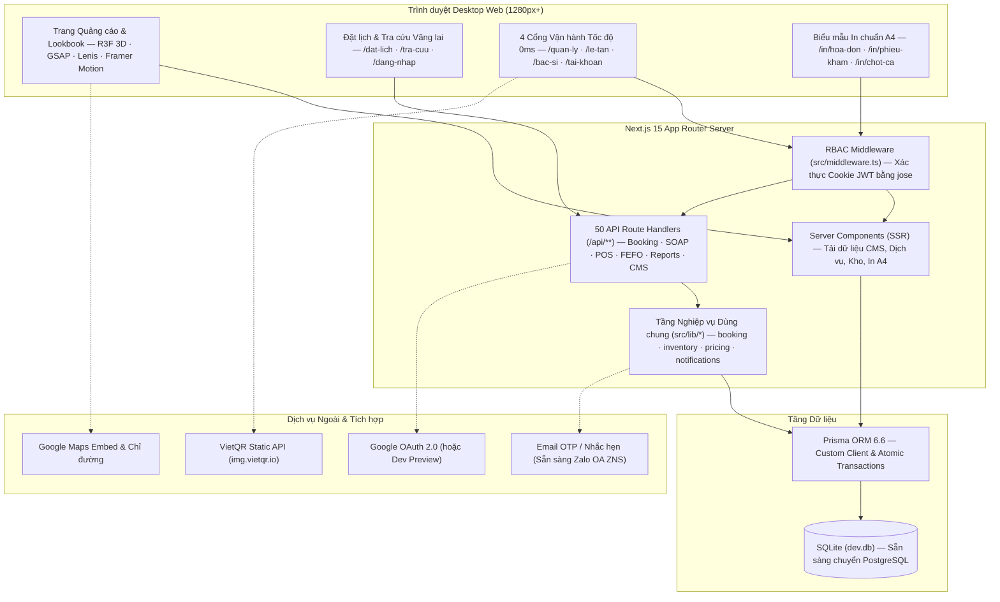
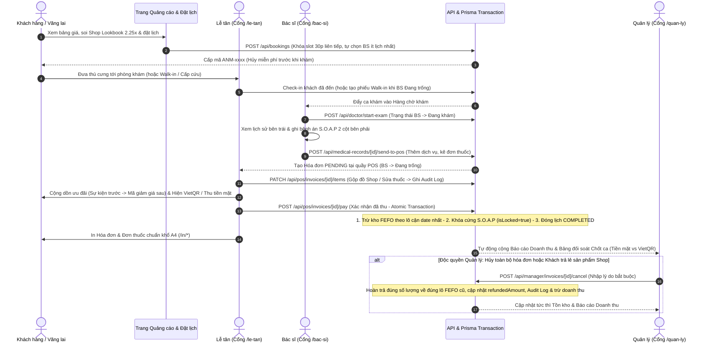

<div align="center">

# 🐾 ANIMORA — Hệ thống Quản lý Vận hành Phòng khám Thú y Toàn diện (Desktop Web)

**Hợp nhất Trải nghiệm Khách hàng (Public Lookbook & Đặt lịch) · Bệnh án Điện tử S.O.A.P · Quầy Thu ngân POS VietQR · Kho Đa lô FEFO trong một nền tảng duy nhất.**

*Chuyển hóa từ **AURA** (ánh sáng dịu lành) sang **ANIMORA** — chữ `U` lật ngược 180° thành chữ `N` tựa mái vòm che chở thú cưng, mở rộng `IMO` cùng chấm cam san hô ấm áp biểu trưng cho chuẩn mực y khoa gắn liền với tình yêu thương.*

[](https://nextjs.org/)
[](https://react.dev/)
[](https://www.typescriptlang.org/)
[](https://tailwindcss.com/)
[](https://www.prisma.io/)
[](https://www.sqlite.org/)
[](https://docs.pmnd.rs/react-three-fiber)
[](https://www.framer.com/motion/)
[](https://gsap.com/)

</div>

---

## 📑 Mục lục (Table of Contents)

1. [Header, Định vị Thương hiệu & Huy hiệu](#top)
2. [Tổng quan Dự án & Phạm vi Vận hành](#2-tổng-quan-dự-án--phạm-vi-vận-hành)
3. [Hệ thống Thiết kế UI/UX ("Tactile Spatial Medical")](#3-hệ-thống-thiết-kế-uiux-tactile-spatial-medical)
4. [Tech Stack & Thư viện Chi tiết](#4-tech-stack--thư-viện-chi-tiết)
5. [Kiến trúc Hệ thống & Cấu trúc Thư mục](#5-kiến-trúc-hệ-thống--cấu-trúc-thư-mục)
6. [Thiết kế Cơ sở Dữ liệu (Database Schema & ERD)](#6-thiết-kế-cơ-sở-dữ-liệu-database-schema--erd)
7. [Phân tích Nghiệp vụ, Ma trận Phân quyền (RBAC) & Luồng Vận hành](#7-phân-tích-nghiệp-vụ-ma-trận-phân-quyền-rbac--luồng-vận-hành)
8. [Danh mục Màn hình & Hệ thống API (Routes Overview)](#8-danh-mục-màn-hình--hệ-thống-api-routes-overview)
9. [Hướng dẫn Cài đặt, Cấu hình & Khởi chạy (Getting Started)](#9-hướng-dẫn-cài-đặt-cấu-hình--khởi-chạy-getting-started)
10. [Tài khoản Mẫu Kiểm thử & Kịch bản Demo nhanh](#10-tài-khoản-mẫu-kiểm-thử--kịch-bản-demo-nhanh)
11. [Thư viện Ảnh chụp Màn hình (Screenshots Showcase)](#11-thư-viện-ảnh-chụp-màn-hình-screenshots-showcase)
12. [Định hướng Mở rộng & Triển khai Production](#12-định-hướng-mở-rộng--triển-khai-production)

---

## 2. Tổng quan Dự án & Phạm vi Vận hành

### Bài toán thực tế giải quyết

Các phòng khám thú y hiện nay thường bị phân mảnh công cụ: website quảng cáo tách rời sổ lịch giấy/Zalo, bác sĩ ghi bệnh án rời rạc khó tra cứu tiền sử, quầy thu ngân tính tiền thủ công dễ lệch tồn kho thuốc–shop và khó đối soát doanh thu cuối ca.

**ANIMORA** giải quyết triệt để bằng cách hợp nhất **3 trụ cột vận hành cốt lõi** trên cùng một cơ sở dữ liệu nhất quán:

1. **Trang Quảng cáo Chuẩn Thương hiệu & Đặt lịch Trực tuyến (Y tế + Spa/Grooming):** Hiển thị bảng giá niêm yết cố định, thư viện sản phẩm Shop dạng *Interactive Lookbook* siêu chi tiết, đội ngũ bác sĩ 2.5D, chương trình ưu đãi đồng bộ từ CMS, bản đồ Google Maps và hệ thống đặt lịch thông minh theo slot 30 phút.
2. **Tiếp nhận & Khám chữa bệnh Chuẩn Thú y (Bệnh án S.O.A.P):** Điều phối lịch trực xoay ca, check-in chống trùng phiếu, tiếp nhận ca cấp cứu/vãng lai theo trạng thái trực thực tế của bác sĩ, ghi bệnh án S.O.A.P thuần văn bản 2 cột, khóa cứng pháp lý sau thanh toán và tự động nhắc lịch tái khám/tiêm phòng.
3. **Quầy Thu ngân POS, VietQR & Quản lý Kho Hợp nhất Đa lô (FEFO):** Gộp hóa đơn khám + sản phẩm Shop, chỉnh sửa thuốc có **Audit Log**, cộng dồn đa khuyến mãi theo đúng thứ tự kế toán, thanh toán Tiền mặt hoặc VietQR tĩnh tự điền số tiền, trừ kho tự động theo hạn sử dụng gần nhất (**FEFO**), in ấn chuẩn khổ **A4**, đối soát chốt ca cuối ngày và báo cáo doanh thu đa chiều.

### Đặc thù Kiến trúc & Phạm vi Triển khai

| Tiêu chí | Đặc tả thực tế trong ANIMORA |
| :--- | :--- |
| **Nền tảng mục tiêu** | **Desktop Web** tối ưu chuyên sâu cho màn hình máy tính từ **`1280px+`** (không đánh đổi mật độ thông tin y khoa sang bố cục mobile). |
| **Quy mô cơ sở** | Vận hành chuyên biệt cho **1 cơ sở phòng khám duy nhất** (mẫu dữ liệu: *128 Nguyễn Thị Minh Khai, P. Võ Thị Sáu, Q.3, TP. HCM*). |
| **Khung giờ & Slot** | Mở cửa **`07:00 – 20:00`** hàng ngày, chia ô đặt lịch mặc định **`30 phút`**. |
| **Cơ chế 2 ca trực xoay vòng** | **Ca sáng (`07:00 – 13:30`)** và **Ca chiều (`13:30 – 20:00`)** đảm bảo phòng khám trực xuyên trưa; tích hợp công tắc **bật/tắt khung Nghỉ trưa (`12:00 – 13:30`)** ngay tại cổng Lễ tân (`ClinicSettings.lunchBreakEnabled`). |

### Các Điểm nhấn Kiến trúc Khác biệt

- **Cô lập hoàn toàn dữ liệu Khách vãng lai (Guest Isolation):** Khách đặt lịch không cần tài khoản sẽ nhận mã `ANM-xxxx` để tự tra cứu/hủy qua SĐT. Hệ thống **tuyệt đối không** tạo bản ghi rác trong bảng `User` hay `Pet` — dữ liệu khách vãng lai chỉ đính kèm dạng snapshot trên `Booking`, `BookingPet`, `Invoice`, và vẫn lưu bệnh án vào `MedicalRecord` để Quản lý kiểm soát chuyên môn.
- **Shop Tham khảo — Không Giỏ hàng Online:** Trang quảng cáo loại bỏ hoàn toàn giỏ hàng giao tận nhà nhằm đảm bảo bác sĩ/nhân viên tư vấn đúng thể trạng thú cưng trực tiếp tại quầy. Thay vào đó, người dùng được trải nghiệm kính lúp soi bao bì (`2.25×`) và 5 thẻ thông tin chuyên sâu (*Thành phần, Công dụng, Đối tượng, Hướng dẫn dùng, Bảo quản*) cùng nhãn tồn kho thực tế.
- **Trừ kho FEFO & Khóa cứng Bệnh án trong 1 Transaction Nguyên tử:** Kho chỉ thực sự trừ hàng tại khoảnh khắc Lễ tân bấm **"Xác nhận đã thu"** — đồng thời trừ theo lô có `expiryDate` gần nhất trước (`FEFO`), khóa cứng bệnh án S.O.A.P (`isLocked = true`) và đóng trạng thái lịch hẹn trong duy nhất một `prisma.$transaction`.
- **Bảo toàn Dữ liệu Lịch sử & Nhân văn:** Nhân sự nghỉ việc áp dụng **Xóa mềm** (`isActive = false`), giữ nguyên toàn bộ bệnh án và hóa đơn cũ; Thú cưng có trạng thái **`DECEASED` ("Đã mất")** tự động ngắt 100% email/nhắc hẹn chăm sóc để tránh gây tổn thương cảm xúc cho chủ nuôi.

---

## 3. Hệ thống Thiết kế UI/UX ("Tactile Spatial Medical")

### Triết lý Thiết kế & Phân tách Hiệu năng 2 Tầng

ANIMORA xây dựng ngôn ngữ thị giác **Tactile Spatial Medical** — dung hòa giữa **độ chính xác vô trùng của y khoa** và **chiều sâu xúc giác ấm áp** (*Soft Clay*, *Medical Frosted Glass*, *Paper Grain*):

| Tầng Trải nghiệm | Phạm vi tuyến trang | Triết lý chuyển động & Hiệu năng |
| :--- | :--- | :--- |
| **Tầng 1: Trang Quảng cáo & Lookbook** | `/`, `/san-pham/[slug]` | Giàu chiều sâu **3D WebGL (React Three Fiber)**, **GSAP Preloader**, **Lenis Smooth Scroll**, **Framer Motion** (`Shared Layout`, `Magnetic Button`, `3D Tilt`). Tạo ấn tượng thương hiệu cao cấp chuẩn quốc tế ngay từ giây đầu tiên. |
| **Tầng 2: 6 Phân hệ Vận hành (Dashboard)** | `/quan-ly`, `/le-tan`, `/bac-si`, `/tai-khoan`, `/dat-lich`, `/tra-cuu`, `/in/*` | **Tốc độ phản hồi `0ms`** — tắt hoàn toàn 3D WebGL và Lenis Smooth Scroll. Sử dụng bề mặt `.tactile-surface` độ tương phản dịu mắt phục vụ nhân viên trực 8 tiếng/ngày, kết hợp **hệ thống cảnh báo thị giác nhận diện trong 0.5 giây**. |

### Bảng Design Tokens Chi tiết

#### 1. Bảng màu chuẩn (`src/app/globals.css`)

| Token CSS | Mã HEX | Tên màu | Vai trò & Công dụng thực tế |
| :--- | :--- | :--- | :--- |
| `--color-primary` | `#0F766E` | **Xanh Ngọc Y Khoa** | Màu thương hiệu chủ đạo, nút thao tác nghiệp vụ, tiêu đề logo, thẻ Y tế, đường viền hào quang 3D. |
| `--color-primary-dark` | `#0B5D56` | Xanh Ngọc Sâu | Trạng thái hover cho nút chính, header bảng dữ liệu. |
| `--color-primary-light` | `#CCFBF1` | Xanh Ngọc Nhạt | Badge trạng thái an toàn, ánh sáng phản chiếu môi trường 3D. |
| `--color-surface` | `#FAF9F6` | **Trắng Kem Ấm** | Nền trang toàn cục thay cho trắng gắt `#FFFFFF` giúp giảm mỏi mắt. |
| `--color-surface-card` | `#FFFFFF` | Trắng Tinh Khiết | Bề mặt thẻ `.tactile-surface`, phiếu S.O.A.P, mẫu in A4. |
| `--color-accent` | `#F97316` | **Cam San Hô Ấm** | Điểm nhấn CTA (*Đặt lịch ngay*), chấm sáng trên chữ `I` của logo, nhóm dịch vụ Spa/Grooming. |
| `--color-accent-hover` | `#EA580C` | Cam San Hô Đậm | Trạng thái hover của CTA và nhãn cảnh báo mua tại quầy. |
| `--color-ink` | `#132A2E` | **Xanh Than Sâu** | Màu chữ chính, nền màn hình Preloader, pill kính tối `.glass-dark-pill`. |
| `--color-ink-muted` | `#476268` | Xanh Than Dịu | Chữ mô tả phụ, nhãn đơn vị, thông số thứ cấp. |
| `--color-urgent` | `#DC2626` | **Đỏ Cảnh báo Khẩn** | Viền & dải nhấn cảnh báo trễ hẹn > 20 phút, bác sĩ nghỉ đột xuất, lô cận date < 30 ngày, tồn kho âm. |
| `--color-urgent-rose` | `#E11D48` | Đỏ San Hô (Pulse) | Vòng sáng `urgentGlowPulse` và badge khẩn `.alert-urgent-badge`. |

#### 2. Typography & Chất liệu Bề mặt

- **Tiêu đề & Logo (`--font-heading`):** **`Plus Jakarta Sans`** (`500, 600, 700, 800`, subset `vietnamese`) — hình học hiện đại, sắc nét.
- **Văn bản Y khoa, Bảng giá & Số liệu (`--font-body`):** **`Be Vietnam Pro`** (`400, 500, 600, 700`, subset `vietnamese`) kết hợp utility **`.tabular-nums-strict`** (`font-variant-numeric: tabular-nums; font-feature-settings: "tnum" 1`) giúp mọi cột giá tiền VNĐ, chỉ số sinh tồn, số lượng kho và đồng hồ đếm ngược thẳng hàng tuyệt đối không bị nhảy chữ.
- **Lớp phủ Hạt giấy Y khoa (`TactileGrainOverlay`):** SVG `<feTurbulence type="fractalNoise" baseFrequency="0.82" numOctaves="3">` ở độ mờ `0.032` (`mix-blend-multiply`), tự động ẩn khi in (`no-print`).
- **Medical Frosted Glass:** 3 biến thể `.glass-medical`, `.glass-medical-card`, `.glass-dark-pill` dùng `backdrop-filter: blur(20px–24px) saturate(135%–145%)` kết hợp lưới chấm `.medical-dot-grid` (`22px × 22px`).

### Kịch bản Logo động 1.8 giây (`AURA → ANIMORA`)

Triển khai đồng bộ ở cả **Preloader toàn màn hình bằng GSAP** (`src/components/public/AnimoraPreloader.tsx` — chạy 1 lần/phiên qua `sessionStorage` và phát lại qua sự kiện `animora:replay-preloader`) và **Logo tương tác bằng Framer Motion** (`src/components/AnimoraLogo.tsx`):

| Nhịp | Thời điểm | Diễn hoạt kỹ thuật |
| :--- | :--- | :--- |
| **Nhịp 1** | `0.00s – 0.45s` | Xuất hiện cụm chữ **`A U R A`** với vệt ánh sáng nghiêng `-skew-x-12` quét ngang màu Xanh Ngọc (`#0F766E` → `#5EEAD4`). |
| **Nhịp 2** | `0.45s – 0.95s` | Chữ **`U`** lật ngược **`180°`** theo trục dọc (`rotateX`, `perspective: 520px`, `backfaceVisibility: hidden`) biến hình thành chữ **`N`** cùng đường hào quang mái vòm SVG (`A N R A`). |
| **Nhịp 3** | `0.95s – 1.46s` | Hai cụm **`AN`** và **`RA`** tách ngang mở khe rộng `3.28ch` để **`I M O`** trượt nhịp nhàng vào giữa với hiệu ứng stagger tạo thành **`A N I M O R A`**. |
| **Nhịp 4** | `1.46s – 1.80s` | Chấm sáng màu Cam San Hô (**`#F97316`**) bật nảy (`back.out(2.6)`) trên đỉnh chữ **`I`**. |
| **Mở màn** | `1.82s – 2.38s` | Riêng tại Preloader: chấm cam bung thành vòng tròn ánh sáng (`scale: 46`) kết hợp `clip-path: circle(0% at 50% 48%)` vén màn mở ra toàn bộ nền `#FAF9F6` của Trang chủ (kèm nút *Vào ngay* và fail-safe `3.2s`). |

### Các Kỹ thuật Tương tác Đã Triển khai Trong Mã Nguồn

- **Hero 3D React Three Fiber (`HeroClayScene.tsx` + `HeroSection.tsx`):** Dựng 100% hình học procedural bằng Three.js (không lệ thuộc model ngoài hay file HDR ngoại vi — dùng `<Environment>` với 3 `<Lightformer>` nội bộ), gồm: **Mái vòm kính mờ** (`meshPhysicalMaterial` có `transmission: 0.78`, `ior: 1.45`), **Thú cưng Soft Clay** có nhịp thở và vẫy đuôi theo `useFrame`, **Trái tim Cam San Hô** đập nhịp `lub-dub`, **Lá chắn Dấu cộng Y tế**, **Dấu chân 3D** và **Các viên cầu kính** chuyển động Parallax theo tọa độ chuột với hệ số lerp khác nhau (`0.38×`, `0.55×`, `0.72×`) và thu nhỏ mượt theo `useScroll`. Tải động `next/dynamic({ ssr: false })` để không chặn SSR.
- **Magnetic Button (`MagneticButton.tsx`):** Dùng `useMotionValue` + `useSpring` (`stiffness: 260, damping: 18`) hút nhẹ nút CTA chính về phía con trỏ chuột trên Desktop.
- **Lenis Smooth Scroll (`PublicSmoothScroll.tsx`):** Chỉ bọc cho Trang Quảng cáo & Trang Chi tiết sản phẩm; tự động tôn trọng `prefers-reduced-motion`, cuộn neo offset `-86px` cho Header cố định và tự gọi `lenis.stop()` khi kích hoạt in ấn (`beforeprint`).
- **Spatial Bento Grid (`ServicesSection.tsx`):** Lưới 12 cột thích ứng (2 thẻ nổi bật 6-6 + các thẻ 4-4-4), hiệu ứng **3D Tilt** theo tọa độ chuột (`rotateX`/`rotateY`), **Spotlight Border** đi theo con trỏ, Segmented Control trượt bằng `layoutId="service-segment-pill"` và **Shared Layout Expansion Modal** (`layoutId="service-card-{id}"`) mở chi tiết quy trình từng bước.
- **Split-Screen Interactive Lookbook & Kính lúp 2.25× (`ShopGallerySection.tsx` + `ProductZoomViewer.tsx`):** Modal chia đôi màn hình (5 cột ảnh cố định trái có zoom phóng đại `2.25×` theo vị trí chuột + 7 cột phải cuộn độc lập với `data-lenis-prevent` chứa 5 thẻ thông số y khoa); chấm đèn xanh ngọc `animate-ping` báo tồn kho thực tế tại quầy.
- **2.5D Doctor Medical ID Cards (`DoctorsSection.tsx`):** Thẻ định danh `ANIMORA MEDICAL ID` (`BS-01..03`) với lớp nền dot-grid mờ sâu đi (`blur-[3px]`) khi chân dung nổi tiến về trước (`-translate-y-2 scale-[1.06]`) và 3 floating badges (*Kinh nghiệm, Lịch trực xoay ca, Chuyên khoa sâu*) trượt ra đồng thời.
- **Hệ thống Cảnh báo Thị giác 0.5s Recognition (`globals.css`):** Kết hợp 3 keyframes `urgentEntryNudge` (rung nhẹ 0.45s khi xuất hiện), `urgentGlowPulse` (hào quang đỏ tuần hoàn 2.4s) và `heartbeatPulse` (nhịp tim 1.8s) cho thẻ `.alert-urgent-card`, dòng `.alert-urgent-row` và badge `.alert-urgent-badge`.
- **Chuẩn In ấn A4 Sắc nét (`globals.css` + `/in/*`):** Khai báo `@page { size: A4 portrait; margin: 12mm; }` cùng `@media print` ép `print-color-adjust: exact`, ẩn thanh công cụ `.no-print`, tắt toàn bộ animation và dãn khổ `.print-a4-sheet` cho 3 biểu mẫu: *Phiếu khám & Đơn thuốc*, *Hóa đơn thanh toán* và *Bảng chốt ca cuối ngày*.

---

## 4. Tech Stack & Thư viện Chi tiết

Toàn bộ phiên bản dưới đây được đối chiếu trực tiếp từ [`package.json`](./package.json) của dự án:

| Nhóm công nghệ | Công nghệ / Thư viện | Phiên bản thực tế | Vai trò kỹ thuật cụ thể trong ANIMORA |
| :--- | :--- | :---: | :--- |
| **Core Framework & Ngôn ngữ** | **Next.js** (App Router) | `^15.3.1` | Full-stack framework: Server Components, API Route Handlers (50 endpoints), Middleware phân quyền RBAC. |
| | **React** & **React DOM** | `^19.1.0` | Thư viện giao diện hiện đại hỗ trợ Concurrent Rendering và Server/Client Component phân tầng. |
| | **TypeScript** | `^5.8.3` | Kiểm tra kiểu tĩnh toàn bộ mã nguồn API, Prisma Client và UI Components. |
| **UI / Styling & Icon** | **Tailwind CSS** & `@tailwindcss/postcss` | `^4.1.4` | Styling utility-first thế hệ v4 (`@theme inline`) quản lý Design Tokens và chuẩn in ấn `@media print`. |
| | **Lucide React** | `^0.503.0` | Bộ biểu tượng vector chuẩn y khoa & giao diện điều khiển đồng nhất nét mảnh. |
| **3D & Animation / Scroll** | **Three.js** (`@types/three`) | `^0.187.0` | Engine đồ họa WebGL dựng mô hình thú cưng Soft Clay, mái vòm kính mờ `MeshPhysicalMaterial` và ánh sáng studio. |
| | **@react-three/fiber** | `^9.8.2` | Trình kết xuất React khai báo cho Three.js, điều khiển vòng lặp `useFrame` 60fps. |
| | **@react-three/drei** | `^10.7.9` | Cung cấp `<Float>`, `<ContactShadows>`, `<Environment>`, `<Lightformer>` cho scene 3D nội bộ. |
| | **Framer Motion** | `^12.6.3` | Logo tương tác, `MagneticButton`, `Shared Layout` Bento Services, modal Lookbook và chuyển tab mượt. |
| | **GSAP** | `^3.15.1` | Timeline điều phối chính xác từng mili-giây cho màn hình `AnimoraPreloader` (1.8s + mở vòng tròn `clip-path`). |
| | **Lenis** | `^1.3.27` | Cuộn mượt vật lý độc lập dành riêng cho Trang Quảng cáo & Trang Chi tiết sản phẩm. |
| **Database & ORM** | **Prisma** & `@prisma/client` | `^6.6.0` | ORM an toàn kiểu dữ liệu (custom output `.prisma/client-animora`), quản lý 23 Model và Transaction nguyên tử. |
| | **SQLite** (Dev) / Sẵn sàng PostgreSQL | Built-in | Cơ sở dữ liệu cục bộ chạy ngay (`prisma/dev.db`), thiết kế schema chuẩn sẵn sàng chuyển sang PostgreSQL. |
| | **tsx** | `^4.19.3` | Chạy trực tiếp script TypeScript `prisma/seed.ts` nạp dữ liệu mẫu. |
| **Biểu đồ & In ấn** | **Recharts** | `^3.11.0` | Vẽ biểu đồ xu hướng doanh thu, phân bổ tỷ trọng 3 mảng (*Y tế / Spa / Shop*) và hiệu suất Bác sĩ tại Dashboard Quản lý. |
| | **CSS `@media print` (A4 Portrait)** | Native CSS | Xuất bản in sắc nét khổ giấy A4 trực tiếp từ trình duyệt không cần thư viện PDF nặng. |
| **Xác thực & Dịch vụ tích hợp** | **jose** | `^6.0.10` | Ký & xác thực JWT (`HS256`, hiệu lực 7 ngày) tương thích Edge Runtime trong `src/middleware.ts`. |
| | **bcryptjs** (`@types/bcryptjs`) | `^3.0.2` | Băm mật khẩu an toàn chuẩn bcrypt (cost factor `10`). |
| | **VietQR Static API** (`img.vietqr.io`) | REST Image | Sinh mã QR chuyển khoản ngân hàng tĩnh điền sẵn `amount`, `addInfo` (`ANIMORA <invoiceCode>`) và tên tài khoản. |
| | **Google Maps** & **Google OAuth 2.0** | REST / Embed | Nhúng bản đồ định vị phòng khám cấu hình động từ CMS; đăng nhập Google OAuth 2.0 (có chế độ `DEV_PREVIEW` cục bộ). |
| | **Notification Provider Layer** | Pluggable TS | Lớp gửi Email OTP & nhắc lịch tái khám (`src/lib/notifications.ts`), có sẵn interface mở cho **Zalo OA (ZNS)**. |

---

## 5. Kiến trúc Hệ thống & Cấu trúc Thư mục

### Sơ đồ Kiến trúc Tổng quan



### Cấu trúc Thư mục Thực tế

```text
animora-clinic/
├── .agent/
│   └── rules/
│       └── animora-rules.md             # 12 quy tắc nghiệp vụ bất di bất dịch & quy chuẩn thương hiệu
├── docs/
│   ├── SPEC.md                          # Đặc tả đầy đủ 6 phân hệ & ma trận phân quyền RBAC
│   └── screenshots/                     # (Thư mục chứa ảnh chụp màn hình minh họa cho README)
├── prisma/
│   ├── schema.prisma                    # Định nghĩa 23 Model cơ sở dữ liệu & các chỉ mục (indexes)
│   ├── seed.ts                          # Script khởi tạo dữ liệu mẫu toàn diện (7 tài khoản, 11 dịch vụ, 14 sản phẩm, đa lô FEFO...)
│   └── dev.db                           # File SQLite cục bộ sau khi db:push & db:seed
├── public/
│   └── images/                          # Ảnh chân dung 3 bác sĩ, ảnh hero và ảnh sản phẩm Shop mẫu
├── src/
│   ├── middleware.ts                    # Chặn truy cập trái phép & điều hướng theo vai trò RBAC (jose JWT)
│   ├── lib/
│   │   ├── auth.ts                      # Đọc/ghi HttpOnly session cookie & helper xác thực server
│   │   ├── session-token.ts             # Ký & kiểm tra JWT HS256 (Edge-compatible), định nghĩa ROLE_META
│   │   ├── prisma.ts                    # PrismaClient singleton (import từ .prisma/client-animora)
│   │   ├── booking-utils.ts             # Tính slot 30p, xoay ca, nghỉ trưa, tự phân công bác sĩ ít lịch nhất, rule trễ 20p
│   │   ├── inventory-utils.ts           # Thuật toán trừ kho FEFO, cho phép tồn âm, hoàn kho hủy/trả hàng chính xác theo lô
│   │   ├── pricing-utils.ts             # Tính cộng dồn đa khuyến mãi (Sự kiện -> Mã giảm giá, sàn 0đ) & buildVietQrUrl()
│   │   ├── notifications.ts             # Kiến trúc NotificationProvider mở (EMAIL hiện tại + placeholder ZALO_ZNS)
│   │   └── format.ts                    # Định dạng tiền VNĐ, ngày giờ, loài thú cưng tiếng Việt
│   ├── components/
│   │   ├── AnimoraLogo.tsx              # Logo động 1.8s (AURA -> ANIMORA) tương tác bằng Framer Motion
│   │   ├── StickyHeader.tsx             # Thanh điều hướng kính mờ cố định & menu vai trò
│   │   ├── RolePortalShell.tsx          # Khung giao diện chuẩn 0ms cho 4 cổng nội bộ
│   │   ├── TactileGrainOverlay.tsx      # Lớp phủ hạt giấy y khoa SVG fractalNoise (tự ẩn khi in)
│   │   ├── public/                      # AnimoraPreloader (GSAP), PublicSmoothScroll (Lenis), MagneticButton, ProductZoomViewer
│   │   ├── landing/                     # HeroSection, HeroClayScene (R3F), PromotionsSection, ServicesSection, ShopGallerySection, DoctorsSection, MapFooterSection
│   │   ├── auth/                        # AuthClient (Đăng nhập, Đăng ký OTP, Google OAuth)
│   │   ├── booking/                     # BookingClient (Đặt lịch đa thú cưng Member/Guest), LookupClient (Tra cứu/Hủy Guest)
│   │   ├── customer/                    # CustomerPortalClient (Hồ sơ, Thú cưng, Lịch hẹn, Lịch sử khám)
│   │   ├── doctor/                      # DoctorPortalClient (Hàng chờ, S.O.A.P 2 cột, Kê đơn, Nghỉ phép, Xuất nội bộ)
│   │   ├── reception/                   # ReceptionPortalClient, ReceptionPosTab, ReceptionRemindersTab, ReceptionShiftTab
│   │   ├── manager/                     # ManagerPortalClient & 7 tab: Dashboard, Invoices, Inventory, Records, Staff, Promotions, CMS
│   │   └── print/                       # PrintTriggerBar (Thanh thao tác in A4 tự ẩn khi in)
│   └── app/
│       ├── layout.tsx & globals.css     # Font Google (Plus Jakarta Sans, Be Vietnam Pro), Design Tokens & @media print
│       ├── page.tsx                     # Trang Quảng cáo công khai (SSR force-dynamic đồng bộ CMS)
│       ├── san-pham/[slug]/page.tsx     # Trang Chi tiết sản phẩm Shop (kính lúp 2.25x, không giỏ hàng)
│       ├── dat-lich/page.tsx            # Trang Đặt lịch trực tuyến (Member & Guest)
│       ├── tra-cuu/page.tsx             # Trang Tra cứu & Hủy lịch dành cho Khách vãng lai
│       ├── dang-nhap/page.tsx           # Cổng Đăng nhập / Đăng ký
│       ├── tai-khoan/page.tsx           # Cổng Khách hàng
│       ├── le-tan/page.tsx              # Cổng Lễ tân & Thu ngân POS
│       ├── bac-si/page.tsx              # Cổng Bác sĩ Khám chữa bệnh
│       ├── quan-ly/page.tsx             # Cổng Quản trị Phòng khám
│       ├── in/                          # 3 trang mẫu in A4: hoa-don/[id], phieu-kham/[id], chot-ca
│       └── api/                         # 50 API Route Handlers (auth, booking/bookings, customer, doctor, reception, medical-records, pos, inventory, leaves, schedules, reports, manager)
├── next.config.ts                       # Cấu hình serverExternalPackages cho Prisma custom client
├── package.json                         # Danh sách thư viện và npm scripts
└── tsconfig.json                        # Cấu hình TypeScript chuẩn path alias @/*
```

---

## 6. Thiết kế Cơ sở Dữ liệu (Database Schema & ERD)

Hệ thống sở hữu **23 Model** được định nghĩa đầy đủ trong [`prisma/schema.prisma`](./prisma/schema.prisma). Để đảm bảo chạy tức thì trên SQLite cục bộ đồng thời dễ dàng nâng cấp sang PostgreSQL, các miền giá trị Enum nghiệp vụ được chuẩn hóa dưới dạng tập giá trị chuỗi có kiểm soát ở tầng nghiệp vụ (ví dụ `role`, `status`, `group`, `paymentMethod`).

### Sơ đồ Quan hệ Thực thể (ERD)

```mermaid
erDiagram
    User ||--o{ Pet : "sở hữu thú cưng"
    User ||--o{ WorkSchedule : "lịch trực tuần"
    User ||--o{ DoctorLeave : "đăng ký nghỉ"
    User ||--o{ Booking : "đặt lịch (Customer)"
    User ||--o{ Booking : "phụ trách (Doctor)"
    User ||--o{ MedicalRecord : "khám bệnh (Doctor)"
    User ||--o{ MedicalRecord : "bệnh án (Customer)"
    User ||--o{ MedicalRecordAddendum : "ghi chú bổ sung"
    User ||--o{ Invoice : "khách hàng / bác sĩ / thu ngân"
    User ||--o{ InvoiceAuditLog : "chỉnh sửa hóa đơn"
    User ||--o{ InternalUsageSlip : "xuất vật tư nội bộ"
    User ||--o{ DisposalSlip : "xuất hủy / kiểm kê"

    Booking ||--o{ BookingPet : "chứa thú cưng"
    Booking ||--o{ MedicalRecord : "tạo ca khám"
    Booking ||--o{ Invoice : "liên kết hóa đơn"

    Pet ||--o{ BookingPet : "được đặt lịch"
    Pet ||--o{ MedicalRecord : "lịch sử bệnh án"

    BookingPet ||--o{ BookingPetService : "dịch vụ đã chọn"
    BookingPet ||--o{ MedicalRecord : "ca khám của bé"
    Service ||--o{ BookingPetService : "tham chiếu bảng giá"
    Service ||--o{ InvoiceItem : "dòng dịch vụ POS"

    MedicalRecord ||--o| Invoice : "xuất 1 hóa đơn POS"
    MedicalRecord ||--o{ MedicalRecordAddendum : "đính chính sau khóa"
    MedicalRecord ||--o{ EmailLog : "nhật ký email"
    MedicalRecord ||--o{ NotificationLog : "nhật ký thông báo"

    Product ||--o{ InventoryBatch : "quản lý đa lô FEFO"
    Product ||--o{ StockTransaction : "biến động tồn kho"
    Product ||--o{ InternalUsageSlip : "vật tư xuất nội bộ"
    Product ||--o{ DisposalSlip : "hàng xuất hủy / kiểm kê"
    Product ||--o{ InvoiceItem : "dòng thuốc / shop POS"

    InventoryBatch ||--o{ StockTransaction : "truy vết theo lô"
    InventoryBatch ||--o{ InternalUsageSlip : "xuất nội bộ từ lô"
    InventoryBatch ||--o{ DisposalSlip : "hủy / điều chỉnh lô"

    Invoice ||--o{ InvoiceItem : "chi tiết hóa đơn"
    Invoice ||--o{ InvoiceAuditLog : "lịch sử sửa tại quầy"

    User {
        string id PK
        string email UK
        string role "MANAGER / RECEPTIONIST / DOCTOR / CUSTOMER"
        boolean isActive "Xóa mềm nhân sự"
        string workStatus "AVAILABLE / IN_EXAM / OFF_DUTY"
    }
    OtpCode {
        string id PK
        string email
        string code
        string purpose "REGISTER / LOGIN"
        datetime expiresAt
    }
    ClinicSettings {
        string id PK "default"
        string openTime "07:00"
        string closeTime "20:00"
        boolean lunchBreakEnabled
        string bankCode
        string googleMapsEmbedUrl
    }
    Promotion {
        string id PK
        string code UK
        string discountType "PERCENT / FIXED"
        string applicableScope "ALL / MEDICAL / SPA / SHOP"
        boolean showOnLanding
    }
    Pet {
        string id PK
        string ownerId FK
        string species "DOG / CAT / OTHER"
        string status "ALIVE / DECEASED"
    }
    Service {
        string id PK
        string slug UK
        string category "MEDICAL / SPA"
        int price "Giá cố định VNĐ"
        int durationMinutes
    }
    Product {
        string id PK
        string sku UK
        string group "SHOP / MEDICINE / SHARED / SUPPLY"
        int conversionRate
        int stockQuantity
    }
    WorkSchedule {
        string id PK
        string doctorId FK
        int dayOfWeek "0..6"
        boolean morningShift
        boolean afternoonShift
    }
    DoctorLeave {
        string id PK
        string doctorId FK
        string leaveDate
        string shift "MORNING / AFTERNOON / FULL_DAY"
        boolean isEmergency
    }
    Booking {
        string id PK
        string bookingCode UK "ANM-xxxx"
        boolean isGuest
        string status "CONFIRMED / CHECKED_IN / IN_PROGRESS / COMPLETED / CANCELLED"
        int totalDurationMinutes
    }
    BookingPet {
        string id PK
        string bookingId FK
        string petId FK
        string guestPetName
    }
    BookingPetService {
        string id PK
        string bookingPetId FK
        string serviceId FK
        int price
        int durationMinutes
    }
    MedicalRecord {
        string id PK
        string recordCode UK
        string status "IN_PROGRESS / SENT_TO_POS / LOCKED"
        boolean isLocked
        datetime followUpDate
    }
    MedicalRecordAddendum {
        string id PK
        string medicalRecordId FK
        string authorId FK
        string content
    }
    EmailLog {
        string id PK
        string medicalRecordId FK
        string recipientEmail
        string channel
    }
    NotificationLog {
        string id PK
        string medicalRecordId FK
        string channel "EMAIL / ZALO_ZNS"
        string status
    }
    InventoryBatch {
        string id PK
        string productId FK
        string batchNumber
        datetime expiryDate
        int remainingQuantity
    }
    StockTransaction {
        string id PK
        string productId FK
        string batchId FK
        string type "IMPORT / SALE_DEDUCT / INTERNAL_USE / DISPOSAL / ADJUSTMENT / RETURN"
        int quantityChange
    }
    InternalUsageSlip {
        string id PK
        string slipCode UK
        string productId FK
        int quantity
    }
    DisposalSlip {
        string id PK
        string slipCode UK
        string type "DISPOSAL / ADJUSTMENT"
        int quantityChange
    }
    Invoice {
        string id PK
        string invoiceCode UK
        string type "CLINIC / RETAIL"
        string paymentMethod "CASH / VIETQR"
        string status "PENDING / PAID / PARTIALLY_RETURNED / CANCELLED"
        int totalAmount
        int refundedAmount
    }
    InvoiceItem {
        string id PK
        string invoiceId FK
        string itemType "SERVICE / MEDICINE / SHOP_PRODUCT"
        int quantity
        int returnedQuantity
    }
    InvoiceAuditLog {
        string id PK
        string invoiceId FK
        string actorId FK
        string action
    }
```



### Chi tiết 6 Nhóm Bảng Nghiệp vụ

| Nhóm nghiệp vụ | Các Model thực tế | Mục đích & Các trường / Ràng buộc cốt lõi |
| :--- | :--- | :--- |
| **1. Người dùng, Phân quyền & Cài đặt CMS** | `User`, `OtpCode`, `ClinicSettings`, `Service` | `User` quản lý 4 vai trò (`MANAGER`, `RECEPTIONIST`, `DOCTOR`, `CUSTOMER`), khóa mềm `isActive`, thông tin chuyên khoa & trạng thái trực bác sĩ (`workStatus`: `AVAILABLE \| IN_EXAM \| OFF_DUTY`). `OtpCode` lưu mã OTP có hạn `expiresAt` và cờ `used`. `ClinicSettings` (bản ghi đơn `id = "default"`) cấu hình nội dung CMS, giờ mở cửa, công tắc nghỉ trưa, tọa độ/nhúng Google Maps và thông tin tài khoản VietQR (`bankCode`, `bankAccountNumber`, `bankAccountName`). `Service` lưu bảng giá cố định `price` và `durationMinutes` theo 2 nhóm `MEDICAL \| SPA`. |
| **2. Khách hàng & Hồ sơ Thú cưng** | `Pet` | Chỉ lưu thú cưng của Khách hàng có tài khoản (`ownerId` → `User`). Lưu đầy đủ đặc điểm y khoa (`species`, `breed`, `birthDate`, `gender`, `isNeutered`, `microchipCode`, `allergies`, `vaccinationHistory`, `dewormingHistory`). Trường `status` (`ALIVE \| DECEASED`) kiểm soát việc dừng toàn bộ nhắc lịch tự động khi bé đã mất. |
| **3. Lịch trực, Nghỉ phép & Đặt lịch** | `WorkSchedule`, `DoctorLeave`, `Booking`, `BookingPet`, `BookingPetService` | `WorkSchedule` có ràng buộc duy nhất `@@unique([doctorId, dayOfWeek])` quy định 2 ca sáng/chiều. `DoctorLeave` lưu ca nghỉ (`MORNING \| AFTERNOON \| FULL_DAY`), cờ khẩn cấp `isEmergency` và `resolvedByReceptionist`. `Booking` hỗ trợ đặt 1 hoặc nhiều thú cưng qua `BookingPet` → `BookingPetService`; đánh chỉ mục `@@index([bookingDate, doctorId])` và `@@index([bookingCode])`; tách rõ `isGuest` cùng các trường snapshot `guestName`, `guestPhone`, `guestPetName`. |
| **4. Khám bệnh S.O.A.P & Ghi chú bổ sung** | `MedicalRecord`, `MedicalRecordAddendum`, `EmailLog`, `NotificationLog` | `MedicalRecord` lưu bệnh án thuần văn bản (`subjective`, `objective`, `weightKg`, `temperatureC`, `heartRate`, `respiratoryRate`, `assessment`, `plan`), lịch hẹn tái khám (`followUpDate`, `followUpNote`), trạng thái gọi nhắc (`reminderCalledAt`) và cơ chế khóa cứng pháp lý (`status`: `IN_PROGRESS \| SENT_TO_POS \| LOCKED`, `isLocked`, `lockedAt`). `MedicalRecordAddendum` chỉ cho phép nối thêm đính chính sau khi khóa. `EmailLog` và `NotificationLog` lưu vết lịch sử gửi nhắc hẹn. |
| **5. Kho Hợp nhất, Đa lô & Biến động Kho** | `Product`, `InventoryBatch`, `StockTransaction`, `InternalUsageSlip`, `DisposalSlip` | `Product` phân 4 nhóm `SHOP \| MEDICINE \| SHARED \| SUPPLY` với hệ số quy đổi `importUnit` → `retailUnit` (`conversionRate`) và tổng tồn `stockQuantity`. `InventoryBatch` quản lý từng lô (`batchNumber`, `expiryDate`, `initialQuantity`, `remainingQuantity`) có index `@@index([productId, expiryDate])` tối ưu truy vấn **FEFO**. `StockTransaction` ghi nhật ký 6 loại giao dịch (`IMPORT`, `SALE_DEDUCT`, `INTERNAL_USE`, `DISPOSAL`, `ADJUSTMENT`, `RETURN`). `InternalUsageSlip` & `DisposalSlip` kiểm soát hao hụt nội bộ, xuất hủy và kiểm kê. |
| **6. Hóa đơn POS, Khuyến mãi & Audit Log** | `Invoice`, `InvoiceItem`, `InvoiceAuditLog`, `Promotion` | `Invoice` tách `type` (`CLINIC \| RETAIL`), ràng buộc 1-1 với `MedicalRecord` (`medicalRecordId @unique`), lưu chi tiết giảm giá 2 tầng (`eventDiscountAmount`, `couponDiscountAmount`), thanh toán đơn phương thức (`CASH \| VIETQR`), trạng thái (`PENDING \| PAID \| PARTIALLY_RETURNED \| CANCELLED`) và `refundedAmount`. `InvoiceItem` theo dõi `returnedQuantity` phục vụ trả hàng từng phần. `InvoiceAuditLog` lưu vết mọi thao tác chỉnh sửa của Lễ tân và Hủy/Trả hàng của Quản lý. `Promotion` cấu hình ưu đãi `PERCENT \| FIXED` theo phạm vi `ALL \| MEDICAL \| SPA \| SHOP`. |

### Các Nguyên tắc Toàn vẹn Dữ liệu (Data Integrity)

1. **Xóa mềm nhân sự (Soft-Delete):** Không xóa vật lý bản ghi `User`; đặt `isActive = false` để vô hiệu hóa đăng nhập ngay lập tức nhưng giữ toàn vẹn khóa ngoại cho mọi `MedicalRecord`, `Invoice` và `InvoiceAuditLog` lịch sử.
2. **Cô lập dữ liệu Khách vãng lai:** `Booking.isGuest = true` luôn có `customerId = null` và `BookingPet.petId = null`, ngăn chặn ô nhiễm sổ quản lý Khách hàng thân thiết nhưng vẫn lưu đủ dữ liệu trên ca khám và hóa đơn để kiểm toán.
3. **Transaction Nguyên tử khi Thu tiền & Trừ kho FEFO (`/api/pos/invoices/[id]/pay`):** Toàn bộ chuỗi *(kiểm tra chống thu trùng → trừ kho FEFO từng lô + ghi `StockTransaction` → cập nhật `Invoice.status = PAID` → khóa cứng `MedicalRecord.isLocked = true` → cập nhật `Booking.status = COMPLETED`)* chạy gọn trong một `prisma.$transaction`. Nếu bất kỳ bước nào lỗi, toàn bộ giao dịch rollback sạch sẽ.
4. **Transaction Nguyên tử khi Quản lý Hủy Hóa đơn / Trả hàng Shop (`/api/manager/invoices/[id]/cancel`):** Đọc lại đúng các bản ghi `StockTransaction` loại `SALE_DEDUCT` (trừ đi các lần `RETURN` trước đó để không bao giờ cộng thừa), hoàn trả chính xác về đúng từng `InventoryBatch` đã xuất, cập nhật `returnedQuantity`, `refundedAmount`, ghi `InvoiceAuditLog` và tự động trừ doanh thu thực tế trong báo cáo.

---

## 7. Phân tích Nghiệp vụ, Ma trận Phân quyền (RBAC) & Luồng Vận hành

### Ma trận Phân quyền (RBAC Matrix)

Đối chiếu thực tế từ [`docs/SPEC.md`](./docs/SPEC.md) và [`src/middleware.ts`](./src/middleware.ts):

| Nhóm chức năng | Khách vãng lai (Guest) | Khách có tài khoản (`CUSTOMER`) | Lễ tân (`RECEPTIONIST`) | Bác sĩ (`DOCTOR`) | Quản lý (`MANAGER`) |
| :--- | :---: | :---: | :---: | :---: | :---: |
| **Xem Trang quảng cáo, Bảng giá, Shop Lookbook, Google Maps** | ✅ | ✅ | ✅ | ✅ | ✅ |
| **Đặt lịch online (1 hoặc nhiều thú cưng) & Hủy không giới hạn** | ✅ *(Mã + SĐT)* | ✅ | Tạo hộ / Hủy hộ | — | Xem |
| **Quản lý hồ sơ cá nhân & Danh sách thú cưng** | — | Tự quản lý | Tạo / Xem | Xem | Toàn quyền |
| **Thiết lập lịch trực cố định tuần, Nghỉ trưa & Điều phối lịch** | — | — | Toàn quyền | Tự đăng ký nghỉ | Xem |
| **Cập nhật trạng thái làm việc (`Trống / Đang khám / Nghỉ`)** | — | — | Xem trực tiếp | Tự cập nhật | Xem |
| **Khám bệnh, ghi bệnh án S.O.A.P & Gửi hóa đơn ra quầy** | — | Xem lịch sử của mình | Xem trạng thái | Toàn quyền | Xem tất cả |
| **Thu ngân POS (Tiền mặt / VietQR), Bán lẻ Shop, Nhắc hẹn & In A4** | — | Xem / In phiếu của mình | Toàn quyền | — | Xem / **Hủy & Trả hàng** |
| **Quản lý Kho FEFO, Xuất hủy, Kiểm kê, Sự kiện, Nhân sự, CMS, Báo cáo** | — | — | — | Tạo phiếu xuất vật tư nội bộ | **Toàn quyền** |

> **Lưu ý kiến trúc Middleware:** Tại `src/middleware.ts`, vai trò `MANAGER` được cấp quyền đi vào cả `/quan-ly`, `/le-tan`, `/bac-si`, `/tai-khoan` và `/in/*` để giám sát vận hành trực tiếp; các vai trò khác bị giới hạn nghiêm ngặt trong đúng phân hệ của mình và tự động điều hướng về Dashboard tương ứng kèm tham số `?notice=khong-du-quyen` nếu truy cập trái tuyến.

### Sơ đồ Luồng Vận hành Khép kín (End-to-End Operations Flow)



### Phân tích Các Quy tắc Nghiệp vụ Cốt lõi (Business Rules)

1. **Khóa slot 30 phút liên tiếp & Tự phân công Bác sĩ (`src/lib/booking-utils.ts`):**
   - Khi khách chọn nhiều dịch vụ cho 1 hoặc nhiều thú cưng trong cùng 1 phiếu đặt, hệ thống cộng dồn `durationMinutes` (làm tròn lên bội số `30 phút`) và tự động khóa toàn bộ các slot liên tiếp tương ứng trên lịch bác sĩ.
   - Nếu khách chọn *"Phòng khám tự phân công"*, hàm `computeDayAvailability` lọc các bác sĩ đang trực phủ kín toàn bộ khoảng thời gian `[startMin, endMin)`, không có `DoctorLeave`, không trùng `Booking`, rồi sắp xếp tăng dần theo tổng số lịch hẹn trong ngày để chọn bác sĩ **ít lịch nhất** (`autoAssigned = true`).
2. **Kiểm soát Trễ hẹn 20 phút, Nghỉ đột xuất & Ca Walk-in/Cấp cứu:**
   - **Quá giờ 20 phút:** Lịch ở trạng thái `CONFIRMED` quá `20 phút` so với `startTime` (`isBookingLate20Min`) sẽ tự động bật cảnh báo **dòng màu đỏ** tại màn hình Lễ tân để gọi xác nhận, nhưng không khóa trạng thái bác sĩ.
   - **Bác sĩ nghỉ phép & Nghỉ đột xuất:** Bác sĩ tự tạo `DoctorLeave` không cần Quản lý duyệt — hệ thống lập tức đóng các slot tương ứng trên web đặt lịch. Nếu đánh dấu `isEmergency = true` và có lịch hẹn trùng ca, cổng Lễ tân lập tức nổi **Cảnh báo khẩn màu đỏ** liệt kê từng lịch bị ảnh hưởng để chuyển bác sĩ hoặc liên hệ khách, rồi đánh dấu đã xử lý (`/api/leaves/[id]/resolve`).
   - **Điều phối Walk-in/Cấp cứu:** Bác sĩ tự quản lý trạng thái (`AVAILABLE` / `IN_EXAM` / `OFF_DUTY`). Lễ tân chỉ đẩy ca vãng lai/cấp cứu vào bác sĩ đang **`AVAILABLE`**.
3. **Thứ tự Cộng dồn Đa Khuyến mãi (`src/lib/pricing-utils.ts`):**
   - **Bước 1:** Áp dụng khuyến mãi **Sự kiện / Dịch vụ** trên tổng tiền của các dòng hàng thuộc đúng `applicableScope` (`ALL`, `MEDICAL` bao gồm cả `MEDICINE`, `SPA`, hoặc `SHOP`).
   - **Bước 2:** Áp dụng tiếp **Mã giảm giá (Coupon)** trên **tổng tiền còn lại** sau bước 1 (chống áp trùng cùng 1 khuyến mãi 2 lần).
   - **Sàn kế toán:** Tổng thanh toán cuối cùng áp sàn tối thiểu **`0đ`** (`Math.max(0, ...)`), không bao giờ âm.
   - **Thanh toán đơn phương thức:** Mỗi hóa đơn chỉ chấp nhận duy nhất **1 trong 2**: `CASH` (tính tự động tiền thối) **hoặc** `VIETQR` (tự sinh QR điền sẵn số tiền và nội dung `ANIMORA <invoiceCode>`).
4. **Quy đổi Đơn vị, Trừ kho FEFO, Tồn kho âm tạm thời & Cảnh báo Cận date (`src/lib/inventory-utils.ts`):**
   - Khi nhập kho theo đơn vị lớn (`Thùng`, `Hộp`) với hệ số `conversionRate`, hệ thống tự quy đổi sang đơn vị nhỏ nhất (`Viên`, `Gói`, `Lọ`, `Túi`, `Cái`) để xuất bán lẻ và kê đơn chính xác.
   - **FEFO (First Expired, First Out):** Hàm `deductStockFEFO` truy vấn các lô còn hàng sắp xếp theo `expiryDate ASC, createdAt ASC`, trừ lần lượt cho đến khi đủ số lượng và ghi chi tiết `StockTransaction` cho từng lô.
   - **Tồn kho âm tạm thời:** Nếu `stockQuantity = 0` nhưng trên kệ thực tế vẫn còn hàng chưa kịp nhập phiếu, giao diện hiển thị **cảnh báo đỏ nổi bật** nhưng vẫn cho phép kê đơn/bán hàng để không làm gián đoạn khách; phần chênh lệch được ghi nhận vào `StockTransaction` với cờ cảnh báo tồn âm.
   - **Cảnh báo cận date:** Mọi lô còn **≤ 30 ngày** hết hạn (`isExpiringWithin30Days`) đều tự động tô đỏ và đưa lên danh sách ưu tiên kiểm soát.
5. **Bảo toàn Dữ liệu & Cảm xúc Chủ nuôi:**
   - Khi Quản lý hoặc chủ nuôi chuyển trạng thái thú cưng sang **`DECEASED` ("Đã mất")**, toàn bộ bệnh án lịch sử vẫn được giữ nguyên để phục vụ thống kê & lưu trữ y khoa, nhưng hệ thống tự động lọc bỏ thú cưng đó khỏi danh sách nhắc lịch tái khám/tiêm phòng và không gửi bất kỳ email chăm sóc nào cho bé nữa.

---

## 8. Danh mục Màn hình & Hệ thống API (Routes Overview)

### Danh mục Toàn bộ 12 Tuyến Trang (Page Routes)

| Vai trò / Nhóm | Đường dẫn (Route) | File nguồn | Chức năng chính |
| :--- | :--- | :--- | :--- |
| **Public (Công khai)** | `/` | `src/app/page.tsx` | Trang Quảng cáo ANIMORA (Preloader 1.8s, Hero 3D, Ưu đãi, Bento Dịch vụ, Lookbook Shop, 2.5D Bác sĩ, Google Maps). |
| **Public (Công khai)** | `/san-pham/[slug]` | `src/app/san-pham/[slug]/page.tsx` | Trang chi tiết sản phẩm Shop với kính lúp phóng đại `2.25×`, 5 thẻ thông số chuyên sâu & chỉ đường đến quầy. |
| **Public / Member** | `/dat-lich` | `src/app/dat-lich/page.tsx` | Đặt lịch trực tuyến hỗ trợ chọn nhiều thú cưng, chọn/tự phân công bác sĩ, khóa slot 30p (Member & Guest). |
| **Guest (Vãng lai)** | `/tra-cuu` | `src/app/tra-cuu/page.tsx` | Tra cứu trạng thái và tự hủy lịch hẹn bằng Mã đặt lịch (`ANM-xxxx`) + Số điện thoại. |
| **Xác thực** | `/dang-nhap` | `src/app/dang-nhap/page.tsx` | Đăng nhập Email/Mật khẩu, Đăng ký xác thực mã OTP Email, Đăng nhập nhanh Google OAuth. |
| **Khách hàng** | `/tai-khoan` | `src/app/tai-khoan/page.tsx` | Quản lý hồ sơ cá nhân, thêm/sửa danh sách thú cưng, theo dõi & hủy lịch hẹn, xem lịch sử khám & hóa đơn. |
| **Lễ tân** | `/le-tan` | `src/app/le-tan/page.tsx` | Điều phối lịch hẹn & lịch trực tuần, công tắc nghỉ trưa, tiếp nhận Walk-in, thu ngân POS & bán lẻ Shop, nhắc hẹn, chốt ca. |
| **Bác sĩ** | `/bac-si` | `src/app/bac-si/page.tsx` | Cập nhật trạng thái trực, hàng chờ khám, ghi bệnh án S.O.A.P 2 cột, ghi chú bổ sung, kê đơn gửi POS, đăng ký nghỉ, xuất vật tư nội bộ. |
| **Quản lý** | `/quan-ly` | `src/app/quan-ly/page.tsx` | 7 phân hệ quản trị: Dashboard Doanh thu, Hóa đơn (Hủy/Trả hàng), Kho FEFO, Hồ sơ ca khám, Nhân sự, Sự kiện Ưu đãi, CMS. |
| **In ấn chuẩn A4** | `/in/phieu-kham/[id]` | `src/app/in/phieu-kham/[id]/page.tsx` | Biểu mẫu in khổ A4 Phiếu khám bệnh S.O.A.P & Đơn thuốc có hướng dẫn dùng. |
| **In ấn chuẩn A4** | `/in/hoa-don/[id]` | `src/app/in/hoa-don/[id]/page.tsx` | Biểu mẫu in khổ A4 Hóa đơn thanh toán POS chi tiết khuyến mãi & phương thức thu tiền. |
| **In ấn chuẩn A4** | `/in/chot-ca` | `src/app/in/chot-ca/page.tsx` | Biểu mẫu in khổ A4 Bảng đối soát chốt ca cuối ngày (tách rạch ròi Tiền mặt vs. VietQR). |

### Hệ thống 50 API Endpoints Thực tế

<details>
<summary><strong>📂 Mở rộng xem đầy đủ 50 API Endpoints (nhóm theo phân hệ nghiệp vụ)</strong></summary>

#### 1. Xác thực & Phiên làm việc (`/api/auth/*`)
| Phương thức | Endpoint | Chức năng |
| :---: | :--- | :--- |
| `POST` | `/api/auth/send-otp` | Tạo và gửi mã OTP xác thực email (5 phút hiệu lực; có `devOtpCode` ở chế độ cục bộ). |
| `POST` | `/api/auth/register` | Đăng ký tài khoản Khách hàng mới sau khi xác thực OTP. |
| `POST` | `/api/auth/login` | Đăng nhập bằng Email/Mật khẩu (kiểm tra `isActive` khóa mềm) và cấp cookie JWT. |
| `POST` | `/api/auth/google` | Đăng nhập Google OAuth 2.0 (hoặc chế độ `DEV_PREVIEW` khi chưa cấu hình Client ID). |
| `POST` | `/api/auth/logout` | Xóa cookie phiên `animora_session`. |
| `GET` | `/api/auth/me` | Lấy thông tin phiên người dùng hiện tại. |

#### 2. Đặt lịch, Tra cứu & Lịch trực (`/api/booking/*`, `/api/bookings/*`, `/api/schedules`, `/api/leaves/*`)
| Phương thức | Endpoint | Chức năng |
| :---: | :--- | :--- |
| `GET` | `/api/booking/availability` | Tính toán toàn bộ slot 30 phút trống/kín trong ngày theo thời lượng dịch vụ, lịch trực, nghỉ trưa và nghỉ phép. |
| `POST` | `/api/bookings` | Tạo phiếu đặt lịch mới (Member hoặc Guest, 1 hoặc nhiều thú cưng, tự phân công bác sĩ ít lịch nhất). |
| `PATCH` | `/api/bookings/[id]` | Cập nhật trạng thái booking (Check-in, chuyển bác sĩ, đổi giờ, hủy hộ). |
| `GET` | `/api/bookings/lookup` | Tra cứu lịch hẹn khách vãng lai bằng `bookingCode` + `phone`. |
| `POST` | `/api/bookings/cancel` | Hủy lịch hẹn không giới hạn thời gian trước khi vào khám (cả Member & Guest). |
| `GET`, `PUT` | `/api/schedules` | Xem và thiết lập ma trận lịch trực tuần cố định của bác sĩ + công tắc bật/tắt nghỉ trưa. |
| `GET`, `POST` | `/api/leaves` | Danh sách lịch nghỉ & Bác sĩ tự đăng ký nghỉ phép / báo nghỉ đột xuất (`isEmergency`). |
| `PATCH` | `/api/leaves/[id]/resolve` | Lễ tân xác nhận đã xử lý xong các lịch hẹn bị ảnh hưởng bởi ca nghỉ đột xuất. |

#### 3. Cổng Khách hàng (`/api/customer/*`)
| Phương thức | Endpoint | Chức năng |
| :---: | :--- | :--- |
| `GET`, `PATCH` | `/api/customer/profile` | Xem và cập nhật thông tin cá nhân của khách hàng. |
| `GET`, `POST` | `/api/customer/pets` | Lấy danh sách và thêm mới hồ sơ thú cưng. |
| `PATCH` | `/api/customer/pets/[id]` | Cập nhật hồ sơ thú cưng (bao gồm tiền sử tiêm phòng, dị ứng, trạng thái). |
| `GET` | `/api/customer/history` | Lấy lịch sử đặt lịch, bệnh án S.O.A.P và hóa đơn của khách hàng. |

#### 4. Cổng Bác sĩ & Bệnh án S.O.A.P (`/api/doctor/*`, `/api/medical-records/*`)
| Phương thức | Endpoint | Chức năng |
| :---: | :--- | :--- |
| `GET` | `/api/doctor/workspace` | Tải không gian làm việc bác sĩ: hàng chờ check-in, ca đang khám, kho thuốc kê đơn và dịch vụ. |
| `PATCH` | `/api/doctor/status` | Bác sĩ tự chuyển trạng thái trực (`AVAILABLE` / `IN_EXAM` / `OFF_DUTY`). |
| `POST` | `/api/doctor/start-exam` | Bắt đầu khám từ booking đã check-in hoặc mở ca khám khách lẻ gấp (tự chuyển trạng thái `IN_EXAM`). |
| `GET`, `PATCH` | `/api/medical-records/[id]` | Đọc lịch sử & lưu nháp nội dung S.O.A.P thuần văn bản (chặn sửa nếu `isLocked = true`). |
| `POST` | `/api/medical-records/[id]/send-to-pos` | Chốt đơn thuốc/dịch vụ phát sinh, tạo Hóa đơn `PENDING` đẩy ra quầy Lễ tân và trả bác sĩ về `AVAILABLE`. |
| `POST` | `/api/medical-records/[id]/addendum` | Thêm "Ghi chú bổ sung" có timestamp & tên tác giả sau khi bệnh án đã bị khóa cứng. |

#### 5. Cổng Lễ tân, Điều phối & Thu ngân POS (`/api/reception/*`, `/api/pos/*`)
| Phương thức | Endpoint | Chức năng |
| :---: | :--- | :--- |
| `GET` | `/api/reception/dispatch` | Tải bảng điều phối trong ngày: danh sách booking (kèm cờ trễ 20p), cảnh báo bác sĩ nghỉ đột xuất, trạng thái bác sĩ. |
| `POST` | `/api/reception/walk-in` | Tiếp nhận nhanh khách vãng lai / cấp cứu và đẩy thẳng vào bác sĩ đang `AVAILABLE`. |
| `GET` | `/api/reception/reminders` | Danh sách ca khám sắp đến hạn tái khám / tiêm nhắc lại (tự động loại bỏ thú cưng `DECEASED`). |
| `POST` | `/api/reception/reminders/[id]/call` | Đánh dấu Lễ tân đã gọi điện nhắc hẹn chăm sóc. |
| `POST` | `/api/reception/reminders/[id]/email` | Gửi email nhắc lịch tái khám và lưu `EmailLog` / `NotificationLog`. |
| `GET` | `/api/pos/invoices` | Lấy danh sách hóa đơn chờ thanh toán & lịch sử hóa đơn + danh mục khuyến mãi/sản phẩm Shop. |
| `PATCH` | `/api/pos/invoices/[id]/items` | Lễ tân gộp thêm đồ Shop hoặc sửa/bỏ thuốc trên hóa đơn chờ (tự động ghi `InvoiceAuditLog`). |
| `POST` | `/api/pos/invoices/[id]/pay` | Xác nhận thu tiền (Tiền mặt / VietQR), cộng dồn khuyến mãi, trừ kho FEFO & khóa cứng bệnh án nguyên tử. |
| `POST` | `/api/pos/retail` | Tạo và thanh toán nhanh hóa đơn bán lẻ Shop (`type = RETAIL`) kèm trừ kho FEFO ngay. |

#### 6. Quản lý Kho Hợp nhất Đa lô FEFO (`/api/inventory/*`)
| Phương thức | Endpoint | Chức năng |
| :---: | :--- | :--- |
| `GET` | `/api/inventory` | Lấy toàn bộ sản phẩm, danh sách lô `InventoryBatch`, cảnh báo cận date < 30 ngày, tồn âm và nhật ký kho. |
| `POST` | `/api/inventory/products` | Thêm mới sản phẩm/thuốc/vật tư vào kho hợp nhất (cài đơn vị nhập, đơn vị lẻ, hệ số quy đổi). |
| `PATCH` | `/api/inventory/products/[id]` | Cập nhật thông tin sản phẩm, giá bán, mô tả Lookbook và bật/tắt hiển thị trên trang quảng cáo. |
| `POST` | `/api/inventory/import` | Nhập lô hàng mới theo đơn vị lớn → tự động quy đổi sang đơn vị nhỏ nhất và ghi `StockTransaction (IMPORT)`. |
| `POST` | `/api/inventory/internal-use` | Lập Phiếu xuất kho nội bộ vật tư tiêu hao (`InternalUsageSlip`) trừ kho theo FEFO (Quản lý & Bác sĩ). |
| `POST` | `/api/inventory/disposal` | Lập Phiếu xuất hủy hàng hết hạn/hỏng vỡ hoặc Điều chỉnh kiểm kê (`DisposalSlip` — Độc quyền Quản lý). |

#### 7. Quản trị Hệ thống, CMS & Báo cáo Doanh thu (`/api/manager/*`, `/api/reports/*`)
| Phương thức | Endpoint | Chức năng |
| :---: | :--- | :--- |
| `GET` | `/api/reports/revenue` | Báo cáo tổng doanh thu (ngày/tuần/tháng/năm), tách 3 mảng Y tế–Spa–Shop, thống kê theo Bác sĩ & bảng chốt ca Tiền mặt vs. VietQR. |
| `POST` | `/api/manager/invoices/[id]/cancel` | Độc quyền Quản lý: Hủy toàn bộ hóa đơn (`FULL_CANCEL`) hoặc Trả lẻ sản phẩm Shop (`PARTIAL_SHOP_RETURN`), hoàn kho chính xác về từng lô FEFO. |
| `GET` | `/api/manager/records` | Tra cứu toàn bộ Hồ sơ ca khám S.O.A.P (bao gồm cả bệnh án khách vãng lai). |
| `PATCH` | `/api/manager/pets/[id]` | Quản lý cập nhật hồ sơ thú cưng, bao gồm chuyển trạng thái `DECEASED` ("Đã mất"). |
| `GET`, `POST` | `/api/manager/staff` | Xem danh sách và tạo mới tài khoản nhân sự (Quản lý, Lễ tân, Bác sĩ). |
| `PATCH` | `/api/manager/staff/[id]` | Cập nhật thông tin chuyên môn bác sĩ hoặc khóa mềm nhân sự (`isActive = false`). |
| `GET`, `POST` | `/api/manager/promotions` | Xem và tạo mới chiến dịch Sự kiện / Mã giảm giá. |
| `PATCH`, `DELETE` | `/api/manager/promotions/[id]` | Bật/tắt hiển thị trên Landing, chỉnh sửa hoặc xóa chương trình ưu đãi. |
| `GET`, `PUT` | `/api/manager/cms/settings` | Xem và cập nhật cài đặt phòng khám, nội dung Hero, Google Maps và tài khoản VietQR. |
| `GET`, `POST` | `/api/manager/cms/services` | Xem và thêm mới gói Dịch vụ Y tế / Spa với mức giá cố định. |
| `PATCH` | `/api/manager/cms/services/[id]` | Cập nhật giá, thời lượng, quy trình từng bước hoặc ẩn/hiện dịch vụ. |

</details>

---

